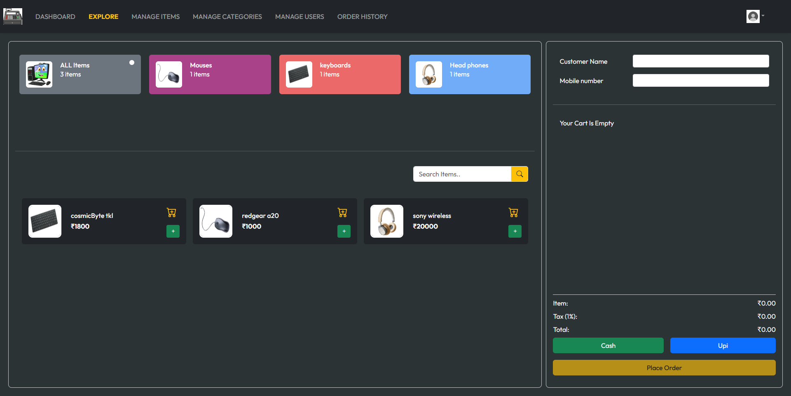
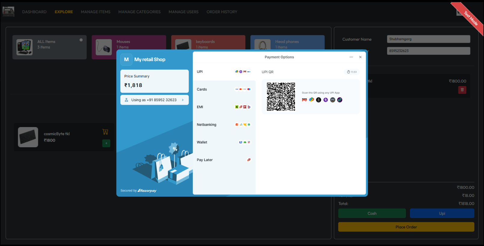
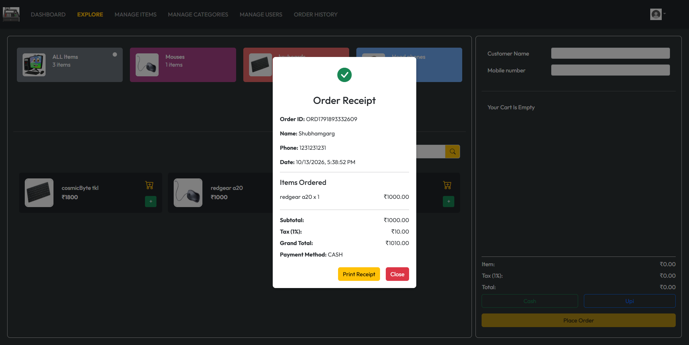
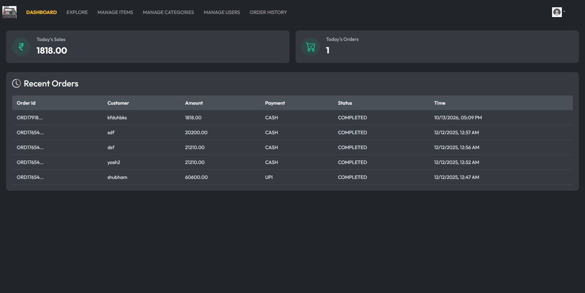
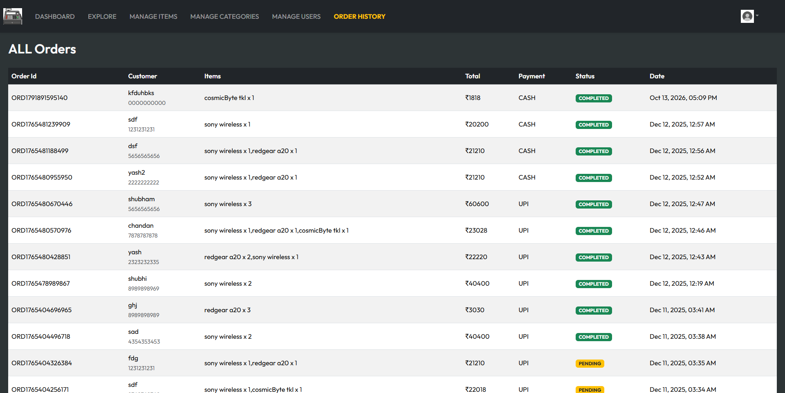
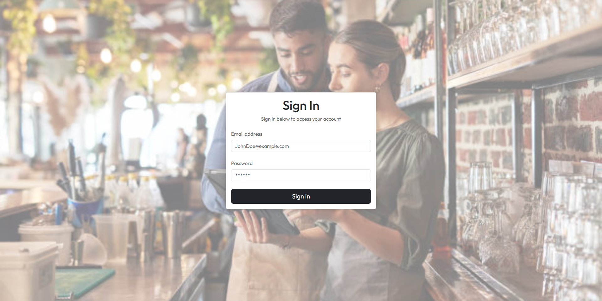
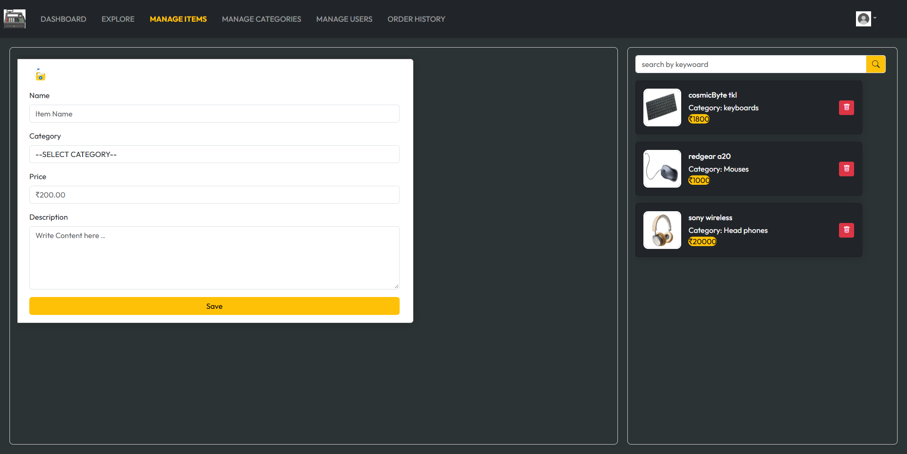
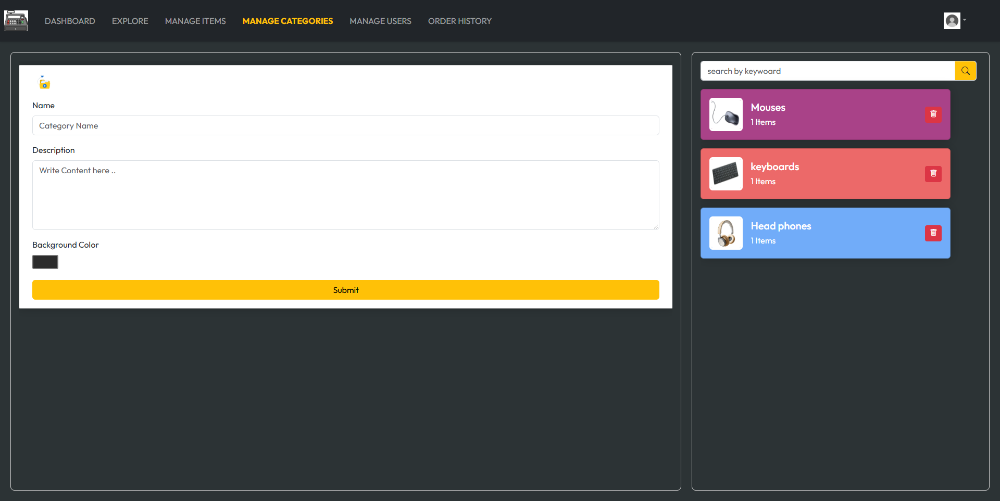
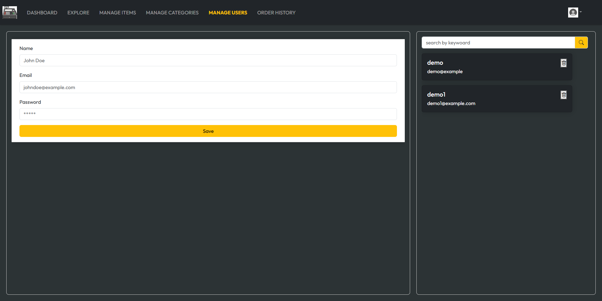

<div align="center">

# 🛒 Retail POS

### A Full-Stack Point-of-Sale & Inventory Management System

[](https://openjdk.org/)
[](https://spring.io/projects/spring-boot)
[](https://react.dev/)
[](https://vitejs.dev/)
[](https://www.mysql.com/)
[](https://aws.amazon.com/s3/)
[](https://razorpay.com/)

</div>

A full-stack point-of-sale and inventory management app for small retail shops. Staff can browse products, build a cart, take payment in cash or UPI (via Razorpay), and print a receipt. Admins also manage the product catalog, categories, and staff accounts, and see daily sales on a dashboard.

- **Backend:** Spring Boot 3.2 (Java 17), Spring Security + JWT, Spring Data JPA, MySQL, AWS S3, Razorpay
- **Frontend:** React 18 + Vite, React Router, Bootstrap 5, Axios, react-hot-toast

---

## Screenshots

### Point of Sale (Explore)


| UPI Payment (Razorpay) | Order Receipt |
| :---: | :---: |
|  |  |

| Dashboard | Order History |
| :---: | :---: |
|  |  |

| Login |
| :---: |
|  |

| Manage Items | Manage Categories | Manage Users |
| :---: | :---: | :---: |
|  |  |  |

---

## Features

### Authentication & roles
- Email/password login that returns a **JWT** (valid for 10 hours) plus the user's role.
- Passwords are hashed with **BCrypt**.
- Two roles: `ROLE_ADMIN` and `ROLE_USER`.
- The frontend stores the token in `localStorage`, attaches it to every request as `Authorization: Bearer <token>`, and sends the user back to `/login` on a `401`.
- Protected routes in React: logged-out users are redirected to `/login`; non-admins are redirected away from admin pages.

### Dashboard (all users)
- **Today's sales** total (₹) and **today's order count**.
- Table of the **5 most recent orders** with customer, amount, payment method, payment status, and time.

### Explore / Point of Sale (all users)
- Browse products by **category** (each category shows its image, colour, and item count).
- **Search** items by name.
- **Cart:** add items, change quantities, remove items.
- **Customer details:** name and mobile number on each order.
- **Bill summary:** subtotal, 1% tax, and grand total.
- **Checkout:** choose **Cash** or **UPI**, then click **Place Order**. Payment options:
  - **Cash:** the order is saved with payment status `COMPLETED`.
  - **UPI / online:** opens Razorpay Checkout. The order starts as `PENDING` and becomes `COMPLETED` once the payment is verified. If the payment fails or the checkout is dismissed, the order is deleted automatically.
- **Receipt popup** opens automatically after a successful cash or UPI payment. It shows the order ID, customer, date, items, totals, payment method, and Razorpay IDs, and the cart is cleared for the next customer.
- **Print receipt:** a print stylesheet prints only the receipt, without the page behind it or the buttons.

### Order history (all users)
- Every order, newest first, with items, total, payment method, status badge, and date.

### Admin: manage categories
- Create categories with a name, description, background colour, and image (uploaded to S3).
- List categories with their item counts.
- Delete a category, which also removes its image from S3.

### Admin: manage items
- Create items with a name, price, description, category, and image (uploaded to S3).
- List and search items.
- Delete an item, which also removes its image from S3.

### Admin: manage users
- Register staff accounts with a name, email, password, and role.
- List and delete users.

---

## Project structure

```
RetailingAndInventoryManager/
├── RetailingAndInventoryManager/        # Spring Boot backend
│   ├── src/main/java/backend/part/RetailingAndInventoryManager/
│   │   ├── config/        # SecurityConfig (JWT, CORS), AwsConfig (S3 client)
│   │   ├── controller/    # Auth, Category, Item, Order, Payment, Dashboard, User
│   │   ├── entity/        # JPA entities: Category, Item, Order, OrderItem, User
│   │   ├── filter/        # JwtRequestFilter
│   │   ├── io/            # Request/response DTOs, PaymentDetails, PaymentMethod
│   │   ├── repository/    # Spring Data JPA repositories
│   │   ├── service/       # Service interfaces + impl/ (incl. S3 upload, Razorpay)
│   │   └── util/          # JwtUtil
│   ├── src/main/resources/application.properties
│   ├── nixpacks.toml, railway.json      # Railway deployment config
│   └── pom.xml
└── client/                              # React + Vite frontend
    ├── src/
    │   ├── Service/       # Axios API client + API calls for each feature
    │   ├── components/    # Cart, CategoryForm, ItemForm, ReceiptPopup, Menubar, ...
    │   ├── context/       # AppContext (auth, categories, items, cart)
    │   ├── pages/         # Dashboard, Explore, ManageItems/Category/Users, OrderHistory, Login
    │   └── util/          # constants (Razorpay key)
    └── vercel.json        # SPA rewrites for Vercel
```

---

## Data model

| Table             | Key fields                                                                                                  |
| ----------------- | ----------------------------------------------------------------------------------------------------------- |
| `tbl_users`       | `userId` (UUID), `name`, `email`, `password` (BCrypt), `role`                                               |
| `tbl_category`    | `categoryId` (UUID), `name` (unique), `description`, `bgColor`, `imgUrl`                                    |
| `tbl_items`       | `itemId` (UUID), `name`, `price`, `description`, `imgUrl`, `category_id` → category                         |
| `tbl_orders`      | `orderId` (`ORD<timestamp>`), `customerName`, `phoneNumber`, `subtotal`, `tax`, `grandTotal`, `paymentMethod` (`CASH`/`UPI`), embedded payment details (Razorpay order/payment/signature IDs, `status`: `PENDING`/`COMPLETED`/`FAILED`), `createdAt` |
| `tbl_order_items` | `itemId`, `name`, `price`, `quantity`, `order_id` → order                                                    |

Hibernate creates and updates the schema automatically (`spring.jpa.hibernate.ddl-auto=update`).

---

## REST API

The base path is **`/api/v1.0`**, and every endpoint except login and encode needs a `Bearer` token.

| Method | Endpoint                           | Description                                                        |
| ------ | ---------------------------------- | ------------------------------------------------------------------ |
| POST   | `/login`                           | Log in with `{ email, password }` → `{ email, token, role }`       |
| POST   | `/encode`                          | Return the BCrypt hash of `{ password }` (used to seed an admin)   |
| GET    | `/categories`                      | List categories with item counts                                   |
| POST   | `/admin/categories`                | Create a category (multipart: `category` JSON + `file` image)      |
| DELETE | `/admin/categories/{categoryId}`   | Delete a category and its image                                    |
| GET    | `/items`                           | List items                                                         |
| POST   | `/admin/items`                     | Create an item (multipart: `item` JSON + `file` image)             |
| DELETE | `/admin/items/{itemId}`            | Delete an item and its image                                       |
| POST   | `/orders`                          | Create an order                                                    |
| GET    | `/orders/latest`                   | List all orders, newest first                                      |
| DELETE | `/orders/{orderId}`                | Delete an order                                                    |
| POST   | `/payments/create-order`           | Create a Razorpay order from `{ amount, currency }`                |
| POST   | `/payments/verify`                 | Verify a Razorpay payment and mark the order `COMPLETED`           |
| GET    | `/dashboard`                       | Today's sales, today's order count, and the 5 most recent orders   |
| POST   | `/admin/register`                  | Create a user from `{ name, email, password, role }`               |
| GET    | `/admin/users`                     | List users                                                         |
| DELETE | `/admin/users/{id}`                | Delete a user                                                      |

<details>
<summary>Example: create order request</summary>

```json
{
  "customerName": "Ravi",
  "phoneNumber": "9876543210",
  "cartItems": [
    { "itemId": "c1f3...", "name": "Coffee", "price": 120.0, "quantity": 2 }
  ],
  "subtotal": 240.0,
  "tax": 2.4,
  "grandTotal": 242.4,
  "paymentMethod": "CASH"
}
```
</details>

<details>
<summary>Example: create item (multipart)</summary>

```bash
curl -X POST http://localhost:8080/api/v1.0/admin/items \
  -H "Authorization: Bearer <token>" \
  -F 'item={"name":"Coffee","price":120,"description":"Hot brew","categoryId":"<categoryId>"};type=application/json' \
  -F "file=@coffee.png"
```
</details>

---

## Getting started

### Prerequisites
- Java 17+ (Maven wrapper included)
- Node.js 18+ and npm
- MySQL 8
- An AWS S3 bucket that allows public-read object ACLs (for product and category images)
- A Razorpay account (test keys are fine)

### 1. Database

```sql
CREATE DATABASE billing_app;
```

### 2. Backend environment variables

`application.properties` reads these variables:

| Variable              | Default                                       | Purpose                                          |
| --------------------- | --------------------------------------------- | ------------------------------------------------ |
| `PORT`                | `8080`                                        | Server port                                      |
| `DATABASE_URL`        | `jdbc:mysql://localhost:3306/billing_app`     | JDBC URL                                         |
| `DB_USERNAME`         | `root`                                        | DB user                                          |
| `DB_PASSWORD`         | —                                             | DB password                                      |
| `JWT_SECRET_KEY`      | —                                             | HMAC signing key, **at least 32 characters**     |
| `AWS_ACCESS_KEY`      | —                                             | S3 access key                                    |
| `AWS_SECRET_KEY`      | —                                             | S3 secret key                                    |
| `AWS_REGION`          | `ap-south-1`                                  | S3 region                                        |
| `AWS_BUCKET_NAME`     | `retail-inventory-solution`                   | S3 bucket                                        |
| `RAZORPAY_KEY_ID`     | —                                             | Razorpay key ID                                  |
| `RAZORPAY_KEY_SECRET` | —                                             | Razorpay key secret                              |
| `CORS_ORIGINS`        | `http://localhost:5173,http://localhost:3000` | Allowed origins (see the CORS limitation below)  |

### 3. Run the backend

```bash
cd RetailingAndInventoryManager
./mvnw spring-boot:run          # Windows: mvnw.cmd spring-boot:run
```

The API is served at `http://localhost:8080/api/v1.0`.

### 4. Create the first admin

Users can only be registered by an admin, so seed the first one directly in the database:

```bash
# Get a BCrypt hash for your password
curl -X POST http://localhost:8080/api/v1.0/encode \
  -H "Content-Type: application/json" \
  -d '{"password":"admin123"}'
```

```sql
INSERT INTO tbl_users (user_id, name, email, password, role, created_at, updated_at)
VALUES (UUID(), 'Admin', 'admin@shop.com', '<hash-from-above>', 'ROLE_ADMIN', NOW(), NOW());
```

### 5. Run the frontend

```bash
cd client
npm install
npm run dev
```

Open `http://localhost:5173` and log in with the admin account.

The API base URL is set in [client/src/Service/apiConfig.js](client/src/Service/apiConfig.js), and the Razorpay key ID is in [client/src/util/constants.js](client/src/util/constants.js). Update both for your environment.

---

## Deployment

- **Backend → Railway:** `nixpacks.toml` and `railway.json` build with `mvn clean package -DskipTests` and start with `java -Dserver.port=$PORT -jar target/*.jar`, restarting on failure. Set the environment variables above in Railway.
- **Frontend → Vercel:** `vercel.json` rewrites all routes to `index.html` so client-side routing works. Build with `npm run build` (output in `dist/`).

---

## Known limitations / TODO

- **Razorpay signature check is a stub.** `verifyRazorpaySignature` in `OrderServiceImpl` always returns `true`. Implement the HMAC-SHA256 check (for example, `Utils.verifyPaymentSignature` from the Razorpay SDK) before going live.
- **Role restrictions on the backend.** `SecurityConfig` matches paths such as `/api/v1.0/admin/**`, but Spring Security matches paths *without* the `/api/v1.0` context path. The `hasRole("ADMIN")` rule therefore never applies, and any logged-in user can call admin endpoints. Change the matchers to `/admin/**`, `/categories`, and so on.
- **CORS origins are hard-coded** to `http://localhost:5173` in `SecurityConfig` (the `@Value("${cors.allowed.origins}")` line is commented out), so `CORS_ORIGINS` currently has no effect.
- **Frontend config is hard-coded.** `apiConfig.js` uses `http://localhost:8080`, and the `.env.*` files are not read. Vite only exposes variables prefixed with `VITE_` through `import.meta.env`, so the `REACT_APP_*` variables in `.env.production` are ignored.
- **Order totals are calculated on the client** and are not re-checked on the server.
- **No stock/quantity tracking yet.** Items have a price but no inventory count.

---

## Tech stack

| Layer     | Tech                                                                                              |
| --------- | ------------------------------------------------------------------------------------------------- |
| Backend   | Spring Boot 3.2, Spring Web, Spring Data JPA, Spring Security, JJWT 0.12.3, Lombok               |
| Database  | MySQL (mysql-connector-j)                                                                         |
| Storage   | AWS S3 (AWS SDK v2)                                                                               |
| Payments  | Razorpay (razorpay-java 1.4.6 + Checkout.js)                                                      |
| Frontend  | React 18, Vite 5, React Router 6, Bootstrap 5, Bootstrap Icons, Axios, react-hot-toast           |
| Hosting   | Railway (API), Vercel (web)                                                                       |

---

## Roadmap

- [ ] Server-side Razorpay signature verification and role checks on admin endpoints
- [ ] Stock quantities with low-stock alerts
- [ ] Barcode scanning for faster checkout
- [ ] PDF receipt generation and email delivery
- [ ] Multi-store / multi-branch support
- [ ] Docker Compose setup for one-command local deployment

---

## Contributing

1. Fork the repository.
2. Create a feature branch: `git checkout -b feature/your-feature-name`
3. Commit your changes: `git commit -m "feat: add your feature"`
4. Push to your fork and open a pull request against `main`.

---

## Author

**Shubham Garg** — Full-Stack Developer (Java · Spring Boot · React)

- GitHub: [@jokerking-6178](https://github.com/jokerking-6178)
- Project: [Retail-POS](https://github.com/jokerking-6178/Retail-POS)

---

<div align="center">

Built with ❤️ using Spring Boot, React, and Razorpay

⭐ Star this repo if you found it useful!

</div>
